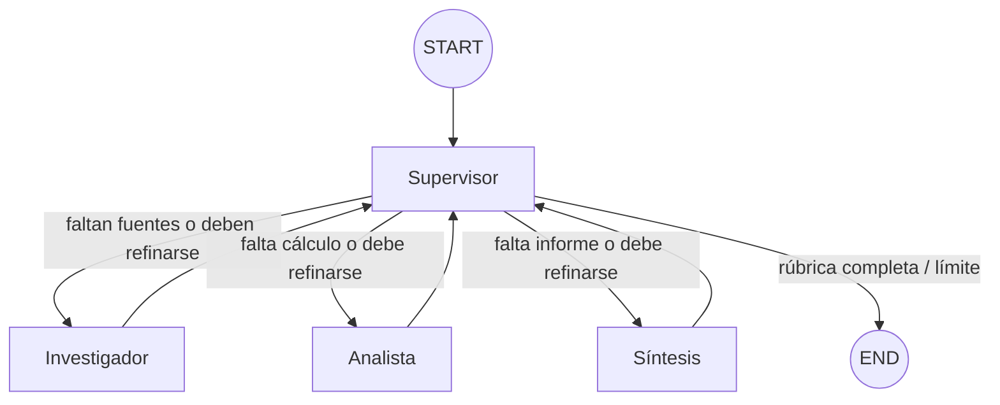

# Pre-entrega 6 — Orquestador multi-agente especializado

Prototipo funcional en Python 3.12 y LangGraph. Implementa una topología jerárquica en la que un
**Supervisor** analiza el estado compartido, evalúa la calidad y delega dinámicamente a tres
especialistas: **Investigador**, **Analista** y **Síntesis**.

La demostración responde esta solicitud:

> Investigá el crecimiento del mercado de energía solar entre 2023 y 2024, calculá la variación
> porcentual y redactá una recomendación ejecutiva basada en fuentes.

## Resultado esperado

El flujo observable es:

```text
Supervisor → Investigador → Supervisor → Analista → Supervisor → Síntesis → Supervisor → END
```

El Supervisor puede reenviar una tarea al mismo especialista si el artefacto no cumple su rúbrica.
Un contador de decisiones y `recursion_limit` evitan correcciones infinitas.

## Diagrama del grafo



Es una **topología jerárquica** porque los especialistas no se llaman entre sí. Todos devuelven su
artefacto al Supervisor, que conserva un punto central de control, auditoría y finalización.

## Responsabilidades

| Componente | Lee | Escribe | Herramientas |
|---|---|---|---|
| Supervisor | Resumen del estado y errores recientes | `next_agent`, feedback, progreso | Ninguna |
| Investigador | Solicitud y feedback | `research_output` | `search_market_data` |
| Analista | Solicitud, investigación y feedback | `analysis_output` | `calculate_percentage_change` |
| Síntesis | Solicitud, investigación y análisis | `final_report` | Ninguna |

Esta separación aplica **aislamiento de escritura**: cada especialista es dueño de una parcela del
estado. Ningún nodo modifica listas globales con `.append()`; devuelve actualizaciones y LangGraph
las combina mediante reducers.

## Estado compartido

`AgentState` hereda de `MessagesState`, por lo que `messages` usa el reducer `add_messages`.
Además incluye:

- `research_output`: evidencia del Investigador.
- `analysis_output`: cálculo del Analista.
- `final_report`: síntesis final.
- `next_agent`: `Literal["researcher", "analyst", "synthesizer", "FINISH"]`.
- `quality_feedback`: instrucciones concretas de refinamiento.
- `step_count` y `max_steps`: freno contra ciclos infinitos.
- `contributions`: registro acumulativo de quién aportó qué.
- `errors`: fallos acumulados y observables por el Supervisor.

Los artefactos se validan con Pydantic antes de ingresar al estado:

```python
class ResearchArtifact(BaseModel):
    query: str
    findings: list[ResearchFinding]
    summary: str
    confidence: float = Field(ge=0.0, le=1.0)
```

## Ruteo dinámico

El Supervisor utiliza salida estructurada:

```python
class SupervisorDecision(BaseModel):
    next_agent: Literal["researcher", "analyst", "synthesizer", "FINISH"]
    reason: str
    quality_feedback: str = ""
```

La arista condicional no busca palabras en el pedido del usuario. Solamente interpreta la decisión
validada del Supervisor:

```python
builder.add_conditional_edges(
    "supervisor",
    route_supervisor,
    {
        "researcher": "researcher",
        "analyst": "analyst",
        "synthesizer": "synthesizer",
        "FINISH": END,
    },
)
```

Después de cada especialista existe una arista directa de vuelta al Supervisor. Esa vuelta permite
que revise el progreso y pida una corrección antes de continuar.

## Rúbrica del Supervisor

El Supervisor considera suficiente cada artefacto cuando:

1. **Investigación:** contiene al menos dos métricas numéricas, períodos, unidades, identificadores
   de fuente y confianza mínima de 0.6.
2. **Análisis:** declara valores, fórmula, resultado e interpretación con confianza mínima de 0.8.
3. **Síntesis:** utiliza evidencia y análisis, cita fuentes, recomienda y declara limitaciones.
4. **Finalización:** solamente selecciona `FINISH` cuando existe un informe final completo.

Si falta calidad, puede seleccionar nuevamente al especialista y escribir `quality_feedback`.

## Herramientas

### `search_market_data`

Consulta una base de conocimiento simulada y asíncrona. Devuelve valores, unidades, períodos y
`source_id`. La simulación hace que la entrega sea reproducible y no dependa de Tavily.

### `calculate_percentage_change`

Calcula:

```text
((valor_final - valor_inicial) / valor_inicial) × 100
```

Con los datos `120` y `144`, devuelve `20%`. Si el valor inicial es cero, devuelve un error
controlado en lugar de derribar el grafo.

## ¿Por qué no se usa `create_react_agent`?

Las versiones actuales de LangGraph marcan `create_react_agent` como obsoleto. Los especialistas
de esta entrega son nodos async con prompts específicos y herramientas acotadas mediante
`bind_tools()`. Esto mantiene la arquitectura pedida y evita depender de una API deprecada.

## Estructura del repositorio

```text
langgraph-multi-agent-orchestrator/
├── src/multi_agent_orchestrator/
│   ├── agents/
│   │   ├── research_agent.py
│   │   ├── analyst_agent.py
│   │   └── synthesis_agent.py
│   ├── config.py
│   ├── graph.py
│   ├── main.py
│   ├── state.py
│   ├── supervisor.py
│   ├── tools.py
│   └── tracing.py
├── notebooks/
│   └── demo_delegacion.ipynb
├── docs/
│   └── resumen_modulo_6.html
├── tests/
│   ├── test_graph.py
│   └── test_tools.py
├── traces/
│   └── example_trace.json
├── .env.example
├── pyproject.toml
└── README.md
```

## Requisitos

- Python 3.12 o 3.13.
- Una API key de OpenAI para la demostración real.
- Git.

## Instalación

```bash
python3.12 -m venv .venv
source .venv/bin/activate
python -m pip install --upgrade pip
python -m pip install -e ".[dev]"
```

En Windows:

```powershell
.venv\Scripts\activate
```

## Configuración

```bash
cp .env.example .env
```

Editá `.env`:

```dotenv
OPENAI_API_KEY=replace_with_your_openai_api_key
OPENAI_MODEL=gpt-4.1-mini
CHECKPOINT_DB_PATH=data/checkpoints.sqlite
TRACE_OUTPUT_PATH=traces/latest_trace.json
THREAD_ID=multi-agent-demo-001
MAX_SUPERVISOR_STEPS=8
```

`.env` está ignorado por Git. Nunca subas tu clave.

## Ejecutar la demostración

```bash
python -m multi_agent_orchestrator.main
```

O mediante el comando instalado:

```bash
multi-agent-demo
```

La terminal muestra cada delegación a medida que ocurre. Al terminar se crean:

- `data/checkpoints.sqlite`: snapshots persistentes del estado.
- `traces/latest_trace.json`: decisiones, contribuciones, artefactos y errores observables.

La traza no intenta almacenar razonamiento privado del modelo.

## Notebook de demostración

El archivo [`notebooks/demo_delegacion.ipynb`](notebooks/demo_delegacion.ipynb) contiene una demo
paso a paso para Jupyter o Google Colab. No incluye outputs ejecutados ni credenciales.

Para abrirlo localmente:

```bash
python -m pip install -e ".[notebook]"
jupyter lab notebooks/demo_delegacion.ipynb
```

## Resumen visual del módulo

[`docs/resumen_modulo_6.html`](docs/resumen_modulo_6.html) explica desde cero las topologías,
el Patrón Supervisor, el estado compartido, `asyncio`, Pydantic y el recorrido de esta entrega.
Es un archivo autónomo: abrilo con doble clic en cualquier navegador.

## Pruebas

```bash
pytest -q
ruff check .
mypy src/multi_agent_orchestrator
```

Las pruebas no usan una API externa ni consumen tokens. Verifican:

- Pydantic rechaza una confianza fuera de rango.
- La búsqueda recupera datos de 2023 y 2024.
- El cálculo produce exactamente 20%.
- La división por cero se convierte en error controlado.
- El Supervisor puede pedir una segunda investigación antes de avanzar.
- El flujo visita Investigador, Analista y Síntesis antes de `END`.
- `max_steps` detiene un Supervisor defectuoso que delega para siempre.

## Manejo de conflictos entre agentes

Los conflictos se reducen mediante cuatro mecanismos:

1. **Propiedad de campos:** cada especialista escribe un campo distinto.
2. **Contratos Pydantic:** un artefacto inválido no entra al estado como si fuera válido.
3. **Rúbrica central:** el Supervisor decide si aceptar o reenviar un resultado.
4. **Trazabilidad:** `contributions` registra agente, estado y resumen de cada aporte.

El Supervisor es intencionalmente un punto central de control. Esta decisión mejora auditoría y
seguridad para un workflow semi-determinista, aunque podría convertirse en cuello de botella en un
sistema de gran escala.

## Seguridad y resiliencia

- Herramientas con permisos mínimos y esquemas de entrada.
- Especialistas reciben solo el contexto necesario, no toda la metadata interna.
- Nodos asíncronos: no se bloquea el event loop mientras se espera I/O.
- Errores de búsqueda y cálculo vuelven como resultados controlados.
- `MAX_SUPERVISOR_STEPS` y `recursion_limit` evitan bucles infinitos.
- API keys y bases SQLite están excluidas por `.gitignore`.
- La demostración usa datos simulados y lo declara en las limitaciones.

## Checklist de la pre-entrega

- [x] Repositorio público preparado para GitHub.
- [x] Python 3.12+, type hints y `asyncio`.
- [x] `state.py` con `MessagesState` y campos estructurados.
- [x] Carpeta `agents/` con Investigación, Análisis y Síntesis.
- [x] Supervisor con decisión estructurada mediante `Literal`.
- [x] Aristas condicionales y retorno de especialistas al Supervisor.
- [x] Herramienta funcional de búsqueda simulada.
- [x] Herramienta funcional de cálculo.
- [x] Rúbrica de validación y posibilidad de refinamiento.
- [x] Límite de pasos y recursión.
- [x] Streaming con `astream`.
- [x] Traza JSON incluida.
- [x] README con diagrama Mermaid.
- [x] Notebook de demostración.
- [x] Variables de entorno sin API keys versionadas.

## Nota de alcance

La base de datos y sus cifras son simuladas para evaluar arquitectura, no investigación de mercado.
En producción, `search_market_data` se reemplazaría por Tavily, un buscador corporativo o una base
vectorial, manteniendo el mismo contrato Pydantic.
