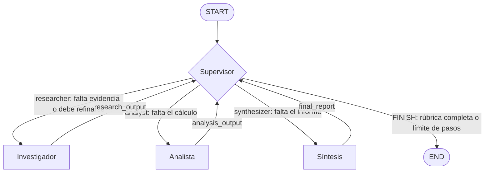

# Pre-entrega 6 — Orquestador multi-agente jerárquico con LangGraph

Prototipo en Python 3.12 y LangGraph de un equipo de agentes coordinado por un **Supervisor**.
El Supervisor lee el estado compartido, decide qué especialista trabaja después, controla la
calidad de cada resultado y termina solo cuando existe un informe final válido.

## ¿Qué problema resuelve?

Un pedido como este mezcla tres trabajos distintos:

> Investigá el crecimiento del mercado de energía solar entre 2023 y 2024, calculá la variación
> porcentual y redactá una recomendación ejecutiva basada en fuentes.

1. **Buscar datos** con fuente (investigación).
2. **Hacer cuentas** con esos datos (análisis).
3. **Redactar** una conclusión (síntesis).

Un único agente con todas las herramientas y un prompt enorme tiende a mezclar tareas, inventar
números o terminar antes de tiempo. Acá cada trabajo lo hace un especialista con su propio prompt,
su propia herramienta y su propia parte del estado, y un Supervisor coordina.

## Conceptos clave (en criollo)

- **Patrón Supervisor:** un nodo central que *solo decide*. No investiga, no calcula y no
  redacta: mira lo que ya existe, elige al próximo especialista y revisa lo que entrega. Como un
  editor jefe que reparte el trabajo en una redacción.
- **Topología jerárquica:** los especialistas nunca se llaman entre sí; todos devuelven el
  trabajo al Supervisor. Se eligió frente a las alternativas porque:

  | Topología | Quién decide | Por qué no / por qué sí |
  |---|---|---|
  | Secuencial | Nadie (orden fijo) | No puede repetir un paso que salió mal. |
  | Colaborativa | Cada agente | Más flexible, pero difícil de predecir, auditar y frenar. |
  | **Jerárquica** | **El Supervisor** | **Un punto central de control de calidad, de auditoría y de parada.** |

  El costo: el Supervisor es un posible cuello de botella (una llamada extra al LLM por paso).
  Para un flujo corto y auditable como este, es un buen intercambio.
- **Arista condicional:** una conexión del grafo cuyo destino depende del estado. Es lo que
  permite la delegación dinámica.
- **Reducer:** la regla con la que LangGraph combina lo que devuelve un nodo con el estado
  anterior (reemplazar o acumular).

## Flujo esperado

```text
START → Supervisor → Investigador → Supervisor → Analista → Supervisor → Síntesis → Supervisor → END
```

El Supervisor puede devolverle el trabajo a un especialista (con `quality_feedback`) si el
resultado no alcanza la rúbrica.



## Qué hace cada agente

| Agente | Lee | Escribe (su parcela) | Herramienta | No hace |
|---|---|---|---|---|
| Supervisor | Pedido, artefactos, errores recientes | `next_agent`, `quality_feedback`, `step_count`, `task_completed` | Ninguna (salida estructurada) | Investigar, calcular, redactar |
| Investigador | Pedido + feedback | `research_output` | `search_market_data` | Calcular o concluir |
| Analista | Pedido + investigación + feedback | `analysis_output` | `calculate_percentage_change` | Buscar fuentes nuevas |
| Síntesis | Pedido + investigación + análisis | `final_report` | Ninguna (salida estructurada) | Buscar datos nuevos |

- **Investigador:** fuerza una llamada a la búsqueda (`tool_choice`) y valida el resultado como
  `ResearchArtifact`: métricas con valor, unidad, período y `source_id`.
- **Analista:** el LLM elige qué dos valores comparar y la herramienta hace la cuenta. Antes de
  calcular se verifica que esos valores **existan en la investigación**, con el mismo período y
  la misma unidad: así no puede usar números inventados. Guarda fórmula, valores, resultado e
  interpretación.
- **Síntesis:** produce un `FinalReport` (resumen, evidencia, recomendación y limitaciones). Se
  rechaza si no cita al menos un `source_id` real de la investigación.

Los especialistas no usan `create_react_agent`: en la versión instalada de LangGraph está marcado
como obsoleto (se movió a `langchain.agents.create_agent`). Son nodos `async` propios que usan
`bind_tools()` o `with_structured_output()`.

## Estado compartido

`AgentState` (en [`state.py`](src/multi_agent_orchestrator/state.py)) hereda de `MessagesState`,
así que `messages` usa el reducer `add_messages`. Además:

| Campo | Tipo | Dueño | Reducer |
|---|---|---|---|
| `request` | `str` | Entrada | Reemplaza |
| `research_output` | `dict \| None` | Investigador | Reemplaza |
| `analysis_output` | `dict \| None` | Analista | Reemplaza |
| `final_report` | `dict \| None` | Síntesis | Reemplaza |
| `next_agent` | `Literal["researcher", "analyst", "synthesizer", "FINISH"]` | Supervisor | Reemplaza |
| `quality_feedback`, `supervisor_reason` | `str` | Supervisor | Reemplaza |
| `task_completed` | `bool` | Supervisor | Reemplaza |
| `step_count`, `max_steps` | `int` | Supervisor / entrada | Reemplaza |
| `contributions` | `list[dict]` | Todos | `operator.add` (acumula) |
| `errors` | `list[str]` | Todos | `operator.add` (acumula) |

**Aislamiento de escritura:** cada especialista solo escribe su parcela. Ningún nodo hace
`.append()` sobre el estado: devuelve un diccionario con los cambios y LangGraph los combina.

**Validación con Pydantic:** cada artefacto se valida antes de entrar al estado. Las reglas son
reales, no decorativas:

- `confidence` debe estar entre 0 y 1 (`Field(ge=0.0, le=1.0)`).
- La investigación necesita al menos un hallazgo y no admite duplicados.
- `AnalysisArtifact` rechaza un `result` que no coincida con la fórmula aplicada a sus valores.
- `FinalReport` exige al menos dos evidencias y una limitación.

Si la validación falla, el artefacto **no** se guarda: el error se registra en `errors` y el
Supervisor decide qué hacer.

## Cómo se manejan los conflictos

1. **Propiedad de campos:** dos agentes nunca escriben el mismo campo.
2. **Contratos Pydantic:** un artefacto inválido no entra al estado.
3. **Prerrequisitos:** el Supervisor no delega en el Analista sin investigación ni en Síntesis
   sin análisis; si el LLM lo intenta, se redirige a la etapa que falta.
4. **Invalidación aguas abajo:** si el Supervisor pide rehacer la investigación, borra el
   análisis y el informe anteriores (estaban calculados con datos viejos). Lo mismo con el
   informe si se rehace el análisis.
5. **Trazabilidad:** `contributions` registra quién aportó qué y con qué fuentes.

## Cómo se evitan los ciclos infinitos

- `max_steps` (variable `MAX_SUPERVISOR_STEPS`, entre 4 y 20; por defecto 8) limita las
  decisiones del Supervisor. El flujo completo necesita 4.
- Si la última decisión permitida no es `FINISH`, el Supervisor corta igual, registra el motivo
  en `errors` y marca `task_completed = False`.
- La función de ruteo también termina si el contador está agotado o si recibe una ruta
  desconocida (protege frente a un Supervisor defectuoso).
- `recursion_limit` de LangGraph se calcula como `2 × max_steps + 2` (cada decisión puede ir
  seguida de un especialista), así el freno propio actúa antes que el de LangGraph.

## Cómo se manejan los errores

| Falla | Dónde | Qué pasa |
|---|---|---|
| Timeout, error de conexión, rate limit, error 5xx, respuesta cortada o rechazo del modelo | Cualquier nodo | Se captura, se registra en `errors` y el grafo sigue. |
| JSON inválido o fuera de contrato (`ValidationError`, `OutputParserException`) | Supervisor | Ruteo defensivo: va a la primera etapa cuyo artefacto falta. |
| `FINISH` sin informe | Supervisor | Se redirige a la etapa que falta. |
| Timeout de la búsqueda | Herramienta | Devuelve `{"status": "error"}`; el Investigador registra el error. |
| División por cero | Herramienta | Devuelve `{"status": "error", "error_type": "ZeroDivisionError"}`. |
| API key inválida (`AuthenticationError`) | `main` | No se reintenta (no tiene sentido): se muestra un mensaje claro, sin traceback ni la clave, y sale con código 1. |

## Herramientas

Definidas con `@tool`, argumentos validados con esquemas Pydantic y asíncronas:

- **`search_market_data(query, limit)`**: busca en una **base de conocimiento simulada** y
  reproducible (mismas entradas, mismos resultados). Devuelve un `ResearchArtifact`.
- **`calculate_percentage_change(start_value, end_value, start_period, end_period)`**: calcula
  `((valor_final - valor_inicial) / valor_inicial) × 100` y devuelve un `AnalysisArtifact`.
  Con los datos de la demo: `((144 - 120) / 120) × 100 = 24 / 120 × 100 = 20%`.

> **La búsqueda es simulada.** Las cifras (120 y 144 millones de USD) son inventadas para evaluar
> la arquitectura, no son investigación de mercado. En producción, `search_market_data` se
> reemplazaría por Tavily, un buscador corporativo o una base vectorial manteniendo el contrato.

## Estructura del repositorio

```text
├── src/multi_agent_orchestrator/
│   ├── agents/
│   │   ├── research_agent.py     # Investigador
│   │   ├── analyst_agent.py      # Analista
│   │   └── synthesis_agent.py    # Síntesis
│   ├── config.py                 # Settings desde variables de entorno
│   ├── errors.py                 # Errores recuperables del LLM
│   ├── graph.py                  # StateGraph y aristas condicionales
│   ├── main.py                   # Demo: streaming, SQLite y traza
│   ├── offline.py                # Modelo determinista sin red (demo y tests)
│   ├── state.py                  # AgentState y contratos Pydantic
│   ├── supervisor.py             # Supervisor, rúbrica y guardas
│   ├── tools.py                  # Herramientas
│   └── tracing.py                # Traza auditable
├── tests/                        # 48 pruebas, sin red ni tokens
├── notebooks/demo_delegacion.ipynb
├── docs/resumen_modulo_6.html    # Resumen de la clase 6
├── traces/example_trace.json     # Traza de ejemplo
├── .env.example
└── pyproject.toml
```

## Instalación

Necesitás **Python 3.12** (o 3.13) y Git.

1. Instalar Python 3.12:
   - macOS (Homebrew): `brew install python@3.12`
   - Windows: instalador de [python.org](https://www.python.org/downloads/) (marcá “Add to PATH”).
   - Linux: `sudo apt install python3.12 python3.12-venv`
2. Clonar el repositorio:

   ```bash
   git clone https://github.com/rguima-ai/langgraph-multi-agent-orchestrator.git
   cd langgraph-multi-agent-orchestrator
   ```

3. Crear y activar el entorno virtual:

   ```bash
   python3.12 -m venv .venv
   source .venv/bin/activate          # macOS / Linux
   # .venv\Scripts\activate           # Windows (PowerShell)
   ```

   Con el entorno activo, el prompt muestra `(.venv)`.
4. Instalar dependencias (el paquete en modo editable más las herramientas de desarrollo):

   ```bash
   python -m pip install --upgrade pip
   python -m pip install -e ".[dev]"
   ```

## Configuración (`.env`)

Solo hace falta para la demo con OpenAI. La demo offline y las pruebas no usan clave.

```bash
cp .env.example .env
```

Editá `.env` y reemplazá el valor de `OPENAI_API_KEY`:

```dotenv
OPENAI_API_KEY=replace_with_your_openai_api_key
OPENAI_MODEL=gpt-4.1-mini
CHECKPOINT_DB_PATH=data/checkpoints.sqlite
TRACE_OUTPUT_PATH=traces/latest_trace.json
THREAD_ID=
MAX_SUPERVISOR_STEPS=8
```

- `THREAD_ID` vacío genera un hilo nuevo por ejecución. Si fijás uno y lo reusás, la ejecución
  continúa ese hilo del checkpoint y sus listas (`contributions`, `errors`, `messages`) se
  acumulan con las de la corrida anterior.
- La clave se maneja como `SecretStr`: no aparece si se imprime la configuración.

> ⚠️ **Nunca subas tu API key.** `.env` está en `.gitignore`. Si una clave llega a un commit,
> revocala en el panel de OpenAI: borrarla del repositorio no alcanza.

## Ejecutar la demo

**Sin API key y sin costo** (modelo determinista local; grafo, herramientas, validaciones y
SQLite son los reales):

```bash
python -m multi_agent_orchestrator.main --offline
```

**Con OpenAI** (consume tokens; requiere `.env`):

```bash
python -m multi_agent_orchestrator.main
# o el comando instalado:
multi-agent-demo
```

La terminal muestra cada delegación a medida que ocurre (`astream` con `stream_mode="updates"`):

```text
=== DELEGACIÓN MULTI-AGENTE (offline) ===
[SUPERVISOR] -> researcher: Falta evidencia con valores, períodos, unidades y fuentes.
[RESEARCHER] trabajo completado
[SUPERVISOR] -> analyst: La evidencia cumple la rúbrica; falta calcular la variación.
[ANALYST] trabajo completado
[SUPERVISOR] -> synthesizer: Investigación y análisis cumplen la rúbrica; falta el informe.
[SYNTHESIZER] trabajo completado
[SUPERVISOR] -> FINISH: El informe final cumple la rúbrica y la tarea está completa.
```

Códigos de salida: `0` tarea completa, `1` error de configuración, `2` terminó sin informe
(por ejemplo, por el límite de pasos).

### Archivos que genera la ejecución

| Archivo | Contenido | ¿Se sube a Git? |
|---|---|---|
| `data/checkpoints.sqlite` | Checkpoints del estado por `thread_id` (`AsyncSqliteSaver`). El directorio se crea si no existe. | No (ignorado) |
| `traces/latest_trace.json` | Decisiones, contribuciones, artefactos y errores de la última corrida. | No (ignorado) |
| `data/notebook_checkpoints.sqlite` | Checkpoints de la demo del notebook. | No (ignorado) |

[`traces/example_trace.json`](traces/example_trace.json) es una traza de ejemplo versionada,
generada con `--offline`.

### Qué contiene la traza (y qué no)

La traza guarda solo campos estructurados: nodo, decisión, `supervisor_reason` (la
justificación breve que el contrato pide de forma explícita), `quality_feedback`, artefactos,
contribuciones y errores. **No** guarda prompts, `messages` ni razonamiento privado del modelo.

## Notebook

[`notebooks/demo_delegacion.ipynb`](notebooks/demo_delegacion.ipynb) recorre el flujo paso a
paso: construcción del equipo, diagrama Mermaid generado desde el grafo, estado inicial,
streaming con SQLite y `thread_id`, informe final, auditoría de contribuciones y recuperación
del hilo desde el checkpoint.

- Por defecto corre en **modo offline** (`USE_OPENAI = False`): no necesita clave.
- **Google Colab:** la primera celda clona el repo e instala el paquete. Para usar OpenAI,
  guardá `OPENAI_API_KEY` en *Secrets*.
- **Jupyter local:**

  ```bash
  python -m pip install -e ".[notebook]"
  jupyter lab notebooks/demo_delegacion.ipynb
  ```

El notebook no incluye outputs ni credenciales.

## Pruebas y calidad

```bash
python -m pytest -q
python -m ruff check .
python -m mypy src tests
```

Las pruebas **no usan la red** (una fixture bloquea cualquier conexión) ni consumen tokens.
Cubren, entre otras cosas:

- Rango de confianza (0 a 1) y resultados inconsistentes con la fórmula.
- Recuperación de los datos 2023 y 2024 con unidad y `source_id`; búsqueda reproducible.
- Cálculo exacto de 20% y división por cero controlada; timeout de búsqueda controlado.
- Refinamiento: el Supervisor pide una segunda investigación antes de avanzar.
- Recorrido completo por los tres especialistas con nodos reales y persistencia en SQLite.
- Condición de parada ante un Supervisor que delega para siempre, y en la última decisión.
- Fallback del Supervisor ante timeout y ante JSON inválido; `FINISH` sin informe.
- Analista que usa valores inexistentes y Síntesis que cita fuentes inventadas.
- **Ensamblado:** `ChatOpenAI` con clave falsa, construcción de los agentes, compilación del
  grafo y generación del Mermaid, sin red.
- **Integración con el `ChatOpenAI` real:** se reemplaza solo `_agenerate` (donde saldría la
  petición HTTP) para comprobar que `bind_tools(tool_choice=...)` y `with_structured_output()`
  funcionan con la versión instalada de LangChain.

## Limitaciones del prototipo

- Los datos de mercado son **simulados**; la búsqueda es léxica sobre cuatro documentos.
- La demo offline prueba la arquitectura, no la calidad de las decisiones de un LLM. La demo con
  OpenAI se verificó con `gpt-4.1-mini` (14/10/2026): recorrió los 7 pasos sin errores, calculó
  20% con los valores investigados y citó fuentes reales. Al ser un LLM, otra ejecución puede
  tomar decisiones distintas (por ejemplo, pedir un refinamiento).
- La rúbrica la aplica el LLM del Supervisor; las garantías deterministas son las guardas
  (prerrequisitos, `FINISH` sin informe, límite de pasos) y las validaciones Pydantic.
- La verificación de citas comprueba que aparezca al menos un `source_id` real, no que cada
  afirmación del informe esté respaldada.
- `quality_feedback` es un único campo: el feedback va siempre al próximo especialista elegido.
- El Supervisor hace una llamada al LLM por paso (costo y latencia extra frente a una secuencia).
- Los esquemas usan `minLength`, `minItems` y rangos numéricos, que el modo estricto de
  *structured outputs* de OpenAI admite en los modelos base (verificado con `gpt-4.1-mini`), pero
  no en modelos *fine-tuned*.
- Con datos irrelevantes en la búsqueda, Síntesis puede incluirlos como evidencia adicional (en
  la corrida real citó también costo de instalación y satisfacción de clientes).
